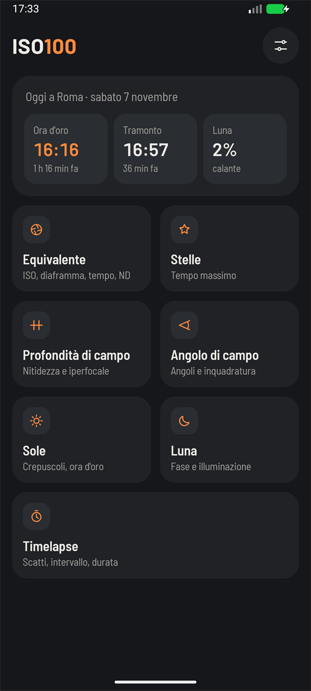
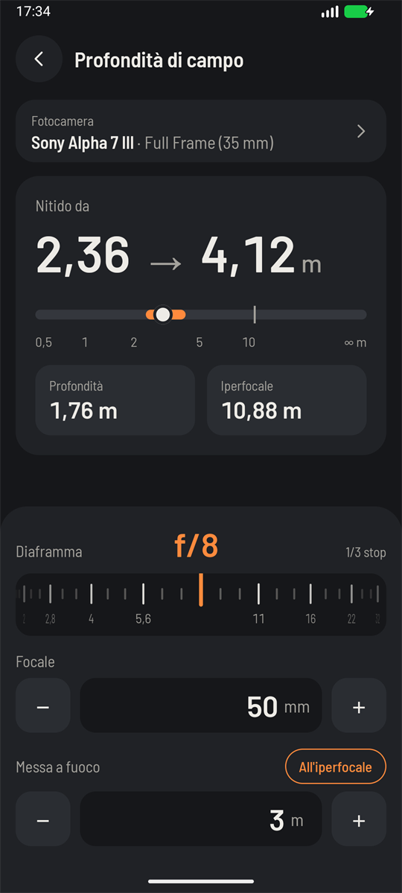
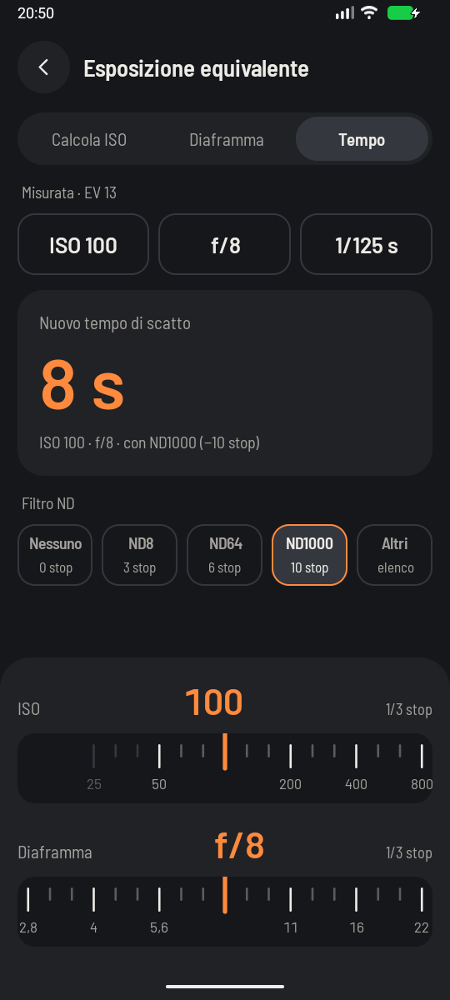
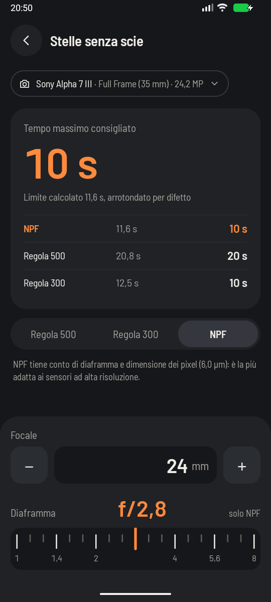
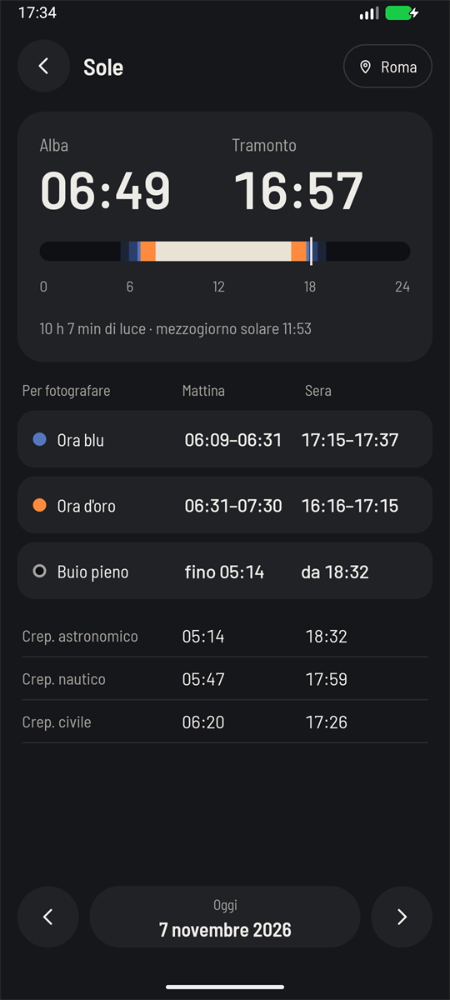
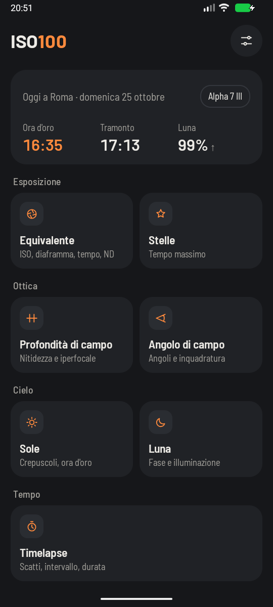
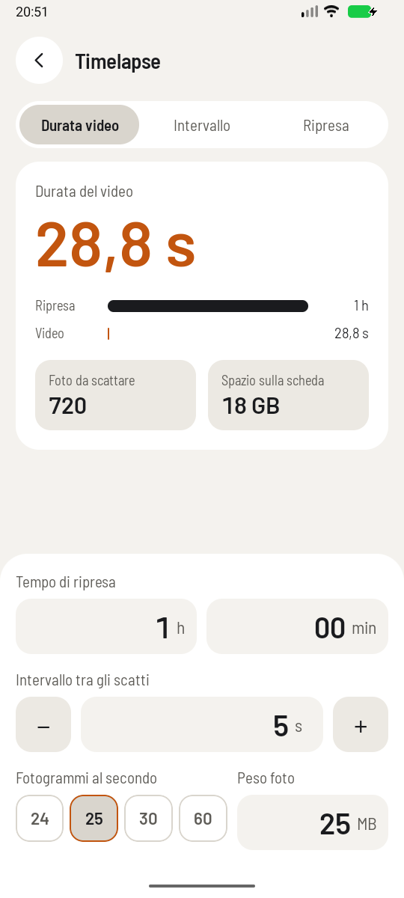
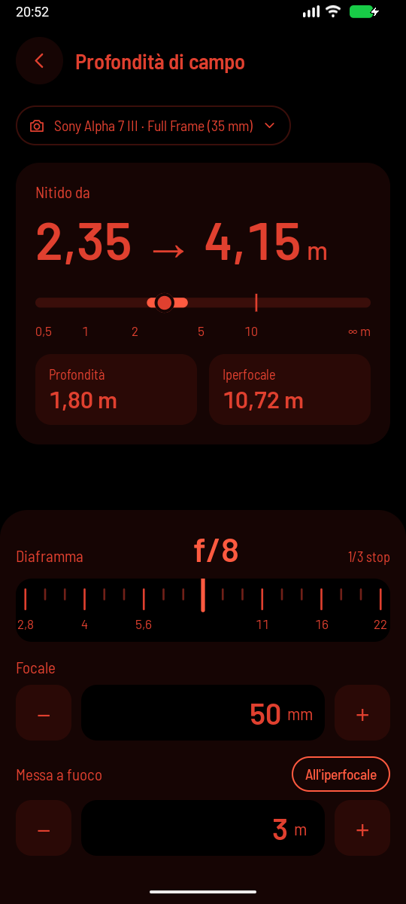

# ISO100

Photography calculator for Android: equivalent exposure and ND filters, depth of field, field of
view, stars without trails, timelapse, sun and moon. Written in Kotlin and Jetpack Compose, with
three themes: dark, light and red night, which preserves your night vision. It replaces the original
[Java app](https://github.com/ziomekmateusz/Iso100-Android-Java) from 2019–2020.

| Home | Depth of field | Equivalent exposure | Stars |
|---|---|---|---|
|  |  |  |  |

| Sun | Moon | Timelapse (light theme) | Red night |
|---|---|---|---|
|  |  |  |  |

## Tools

- [**Equivalent exposure**](docs/guide/exposure.md): the same light with different settings or an ND filter.
- [**Depth of field**](docs/guide/depth-of-field.md): how much of the scene is sharp.
- [**Field of view**](docs/guide/field-of-view.md): what fits in the frame.
- [**Stars without trails**](docs/guide/stars.md): the longest exposure before stars become lines.
- [**Timelapse**](docs/guide/timelapse.md): video length, interval and shooting time.
- [**Sun**](docs/guide/sun.md): sunrise, sunset, twilights, golden hour and blue hour.
- [**Moon**](docs/guide/moon.md): phase, illumination and position.

The [guide](docs/guide/README.md) explains each tool for photographers, formulas included. The app
comes in Italian, English and Polish, with a catalog of 579 cameras and 18 sensor formats.

Only the approximate location permission is needed, and only for sun and moon; the app does not use
the internet.

## Structure

| Folder | What |
|---|---|
| `android/` | Kotlin + Compose app: `:calc` (calculations, pure Kotlin without Android) and `:app` (UI and data) |
| `data/` | catalog of formats and cameras, hand-editable JSON (see `data/README.md`) |
| `tools/` | Go module with the `catalog` CLI (validate, fmt, build, import-lensfun) |
| `docs/` | the [guide](docs/guide/README.md) to the tools, screenshots |

## Architecture

### No ViewModel

Android's guidance recommends a ViewModel as the state holder of a screen. This app deliberately has
none, for two reasons:

- **The app is simple enough.** No screen has async work of its own, the inputs are a few numbers that
  fit in the Bundle, and what outlives a screen (settings, catalog, location) belongs to the app.
- **It is an experiment.** I wanted to try a different way of holding state in Compose, on a project
  small enough to be the right place for it.

State comes in three categories, and each piece lives in only one:

- **Data** (settings, catalog, location, saved places): singleton stores that expose `Flow`.
- **User input**: the composable, with `rememberSaveable`. The values of the tools (not open sheets or
  dates) also have a last copy in `ToolValuesStore`, so a tool opens where the user left it:
  `rememberToolInput` starts from that copy and saves each change.
- **Results**: recomputed by pure functions, never saved.

Without a ViewModel the risk is logic sliding into composables, so each screen has three parts:
`XxxInput` with `reduce(action)` and `XxxUiState.from(...)` are pure functions and carry the logic;
`XxxScreen` only wires them to `rememberSaveable` and the stores; `XxxContent` is stateless and has
the previews.

`XxxContent` reads as an outline of the screen: it composes small named composables (`DofControls`,
`DofResult`, `PickerTopBar`, `CameraItem`) instead of building everything from `Row`, `Column` and
`Text` in one block. Controls shared by several tools live in `ui/components` (`FocalLengthField`,
`ApertureDial`); list sections are `LazyListScope` extensions (`cameraGroups`). A part used once and only
a few lines long stays inline.

A ViewModel would be justified only by a screen with work of its own that must survive rotation, and
even then a store comes first.

### Other choices

- **Two modules.** `:calc` holds the calculations, units, sensor formats, sun and moon in pure Kotlin;
  `:app` holds the UI, the stores and DI. The boundary that matters is "calculations without Android",
  and a separate module lets the compiler enforce it. No layer or feature modules, no use cases.
- **Manual DI.** `AppContainer` builds the stores and composables read it from `LocalAppContainer`.
  Without ViewModels the main reason for Hilt is gone, and a handful of singletons needs no framework.
- **Navigation 3.** One back stack in `Iso100App`: a list of `@Serializable` keys observed as Compose
  state, the same idea as the state above. Screens receive lambdas, never the back stack.
- **No Room.** About 580 cameras (100 KB of JSON) and a few places: the catalog stays in memory, and
  settings and saved places go in DataStore. A database would add KSP, entities, DAOs and migrations
  for no gain.
- **Sun and moon** use commons-suncalc inside `:calc`, behind our own functions and types. Times are
  computed in the zone of the place: Android cannot get a zone from coordinates offline, so each saved
  place stores one, the phone's at first, and the user can change it.
- **Catalog `specs` are unverified.** Calculations use `resolutionMp` only for the NPF rule, and
  `isoMin`/`isoMax` only to dim dial values, never to block them.
- **Errors are values.** `:calc` does not throw on user input: it returns a result or a typed error
  (out of domain, off the scale), never ∞ or NaN, except the far limit of the depth of field, which is
  a modeled case. The UI shows a message instead of a wrong number.

## Commands

You need JDK 17 or newer (the one bundled with Android Studio is fine), the Android SDK with API 37
and Go 1.24.

```sh
# catalog, from the root
go test ./tools/...
go run ./tools/cmd/catalog validate
go run ./tools/cmd/catalog build -out android/app/src/main/assets/catalog.json

# app, from android/
./gradlew :calc:test
./gradlew build          # tests and lint
./gradlew installDebug
```

Visible text lives only in `strings.xml`, kept aligned across `values/` (English), `values-it/` and
`values-pl/`.

The `:calc` tests use values worked out by hand from the formulas in the
[guide](docs/guide/README.md). Sun and moon are checked against sources independent of commons-suncalc:
the NOAA Solar Calculator and the US Naval Observatory.

## Use of AI

This app (or rather rewrite of the original app) was developed largely with Claude Code (Anthropic), under my direction: that covers the
code, tests and documentation. The design and the icon also came from AI tools.

The calculations are checked by tests against values worked out by hand and published sun and moon
data. The app itself has no AI features. 

## License

Copyright 2019–2026 Mateusz Ziomek. The project is licensed under the [Apache License 2.0](LICENSE),
except for the camera catalog and the fonts listed below, which keep their own licenses.

## Third-party licenses

- Camera data derives in part from [Lensfun](https://lensfun.github.io), licensed under
  CC BY-SA 3.0: the derived catalog (`data/` and `android/app/src/main/assets/catalog.json`) has the
  same license (`data/LICENSE-lensfun-CC-BY-SA-3.0.txt`).
- The Barlow and Barlow Semi Condensed fonts (`android/app/src/main/res/font/`) are under the SIL Open
  Font License (`android/app/src/main/assets/licenses/barlow-OFL.txt`).
