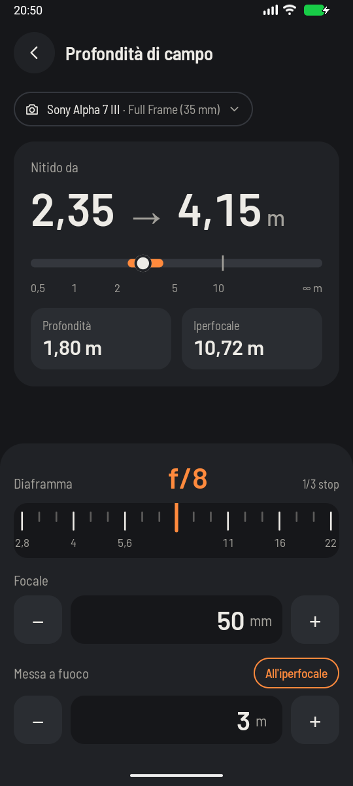

# Depth of field



**The question it answers:** with this lens, this aperture and this focus distance, how much of the
scene will look sharp?

## The idea

Here's the thing nobody tells you at first: a lens focuses on exactly one distance. Everything else is
a little bit blurred. A point of light in front of or behind that distance lands on the sensor as a tiny
disc rather than a point.

As long as that disc is small enough, your eye can't tell it from a point, so it looks sharp. The
largest acceptable disc is called the **circle of confusion**, and the range of distances that stay
under it is the depth of field.

So depth of field isn't a physical edge. Sharpness fades gradually, and "sharp" is an agreement about
how closely someone will look.

## The circle of confusion

The idea comes from a print: on an 8×10 inch print viewed from about 25 cm, a disc of roughly 0.2 mm
passes as a point. Carried back to the sensor, that gives the criterion used by most books, and by
the app:

```text
c = sensor diagonal / 1500
```

That's 0.029 mm on full frame and 0.019 mm on APS-C. A smaller sensor needs more enlargement to reach
the same print, so it tolerates less blur.

If you crop heavily, or pixel-peep at 100%, you are enlarging more than this convention assumes, and
the sharp zone will look thinner than the app says. Treat the numbers as a guide, not a guarantee.

## The maths

Everything starts from the **hyperfocal distance** H, in millimetres, with f the focal length and N
the aperture:

```text
H = f² / (N · c) + f
```

From it, with s the focus distance, come the two limits of the sharp zone:

```text
near limit = s · (H − f) / (H + s − 2f)
far limit  = s · (H − f) / (H − s)
```

### A worked example

50 mm at f/8 on full frame, focused at 3 m:

```text
H    = 50² / (8 · 0.02884) + 50 = 10 884 mm  =  10.9 m
near = 2.36 m
far  = 4.12 m
```

Sharp from 2.36 m to 4.12 m, a depth of 1.76 m.

Now look at where the focus sits: 0.64 m of sharp zone in front, 1.12 m behind. There's more behind
than in front, and this is worth remembering. People say "a third in front, two thirds behind", and at
this distance it's roughly true, but the ratio shifts: up close the split gets closer to even, and as
you approach the hyperfocal the far side stretches away.

## What changes it

Try these on the dial and watch the bar:

| Change | From | To |
|---|---|---|
| Open up to f/2.8 | 1.76 m deep | 0.58 m (2.74 to 3.32 m) |
| Stop down to f/16 | 1.76 m deep | 4.65 m (1.94 to 6.59 m) |

Three things control depth of field: aperture, focal length and distance. Focal length is squared in
the formula, so it has a huge effect, and distance is just as strong. Move closer and the sharp zone
collapses, which is why macro shots have depth measured in millimetres.

## The hyperfocal trick

Look at the far limit formula again. When s reaches H, the bottom becomes zero, and the far limit goes
to infinity. The near limit, meanwhile, works out at exactly H/2.

So focusing at the hyperfocal distance gives you everything from half that distance to infinity. This
is the landscape photographer's favourite trick. With a 24 mm at f/8 on full frame, H is 2.52 m: focus
there and all is sharp from 1.26 m to the horizon.

Press **At hyperfocal** in the app and the focus jumps straight there. Focus any further and you only
waste near sharpness, since the far limit is already at infinity; the app shows ∞ in that case.

## Does a smaller sensor give more depth of field?

Yes and no, and this confuses everyone, so take it slowly.

With the *same* lens, aperture and distance, a smaller sensor gives *less* depth of field on paper,
because its circle of confusion is smaller: that 50 mm at f/8 has a hyperfocal of 10.9 m on full frame
and 16.7 m on APS-C.

But you'd never shoot it that way. The smaller sensor crops the frame, so to get the same picture you'd
use a shorter lens or step back, and both of those add far more depth than the smaller circle removes.
For the same framing, a smaller sensor gives *more* depth of field. That's why phones struggle to blur
a background.

## What the app can't know

- **Diffraction.** Stopping down isn't free. Past about f/11 to f/16 on most cameras, the whole picture
  softens slightly. Going to f/22 for depth can cost you more sharpness than it buys.
- **Your lens.** The formulas assume a simple ideal lens. Real lenses shift their focal length when
  focusing close, so macro numbers are approximate.
- **Close limit.** The focus distance has to be longer than the focal length, or no image forms at
  all, and the app will tell you so.
