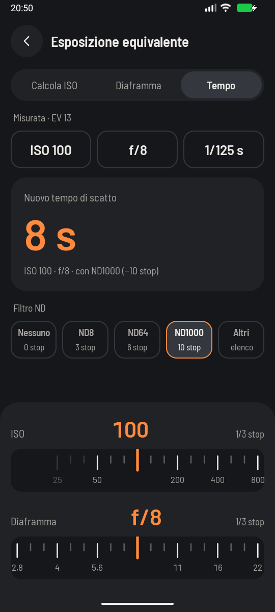

# Equivalent exposure and ND filters



**The question it answers:** I've got a correct exposure. If I change one setting, or put a filter on
the lens, what do I have to change to keep the picture just as bright?

## When you'll use it

Your meter says ISO 100, f/8, 1/125 s, and the picture looks right. But you want to freeze the runner,
or blur the background, or smooth out the sea with a heavy ND filter. Any of those moves one setting,
so another has to move the opposite way by the same number of stops. That's an equivalent exposure:
different numbers, same brightness.

## How to use it

1. Enter the **metered exposure**, the one that looks right.
2. Choose which value you want the app to **calculate**: ISO, aperture or shutter.
3. Set the other two the way you want them.
4. Add an **ND filter** if you're using one.

## The maths

First we boil the metered exposure down to one number, the **exposure value**, which says how much
light the combination of aperture and shutter represents:

```text
EV = log2(N² / t)
```

N is the f-number, t the time in seconds. A log base 2 simply counts doublings, which means counting
stops, so one EV is exactly one stop. ISO 100, f/8, 1/125 s gives EV 13.

EV on its own doesn't describe the scene, because at ISO 400 the same scene gives a different EV. So
we normalise to ISO 100, and that gives the **light value** (LV, or EV100), which only depends on how
bright the scene is:

```text
LV = EV − log2(ISO / 100)
```

A filter takes light away, so we subtract its stops. What's left is the light you have to work with:

```text
light = 2^(LV − filter stops)
```

Then each setting comes from the same relationship, solved for what you want:

```text
new shutter  = N² · 100 / (light · ISO)
new aperture = √(light · t · ISO / 100)
new ISO      = N² · 100 / (t · light)
```

### A worked example

Metered: ISO 100, f/8, 1/125 s, so LV 13. You open up to f/2.8 for a blurred background: that's three
stops more light, so the shutter must be three stops shorter.

```text
t = 8 · 100 / (2^13 · 100) = 1/1024 s  →  1/1000 s
```

Keep f/8 and that 1/1000 s and ask for the ISO instead, and you'll get ISO 800: three stops again.

## ND filters

A neutral density filter is sunglasses for the lens. It's sold by how many times it cuts the light,
and that factor is the only thing you need:

```text
stops   = log2(factor)
density = log10(factor)
```

ND8 is 3 stops, ND64 is 6, and ND1000 is 9.97 (nearly, but not quite, 10). Filter makers often print
the optical density (OD) instead: ND1000 is OD 3. The app shows you all three in the filter list, from
ND2 up to ND1024, with quick buttons for ND8, ND64 and ND1000.

Back to our scene, adding an ND1000 at the same ISO and aperture:

```text
t = 1/128 s · 1000 = 7.8 s  →  8 s
```

A choppy sea at 1/125 s becomes silk at 8 s. Compose and focus *before* you screw on the filter;
through an ND1000 your camera sees almost nothing.

## Reading the result

The big number is the nearest value on your camera's scale, measured in stops, because that's the
value you can actually dial in. If it's more than 1/20 of a stop away from what was calculated, the
exact value appears underneath.

**Out of scale.** The scales run from ISO 25 to 102400, f/0.7 to f/32, and 1/8000 s to 30 s. If the
answer lands more than half a step beyond the end, the app tells you so instead of quietly giving you
the last value, because that would be a wrong exposure with a right-looking number. There's one
exception: a shutter longer than 30 s is a perfectly good answer, and you'll get the calculated time.
Switch to bulb mode and use a timer.

**Dimmed ISO values.** If you've picked a camera whose ISO range is in the catalog, values outside it
appear dimmed on the dial. They aren't blocked, since that data isn't verified and your camera may
well have extended ISOs.

## What the app can't know

- **Reciprocity failure.** On film, long exposures need extra time beyond what the maths says. On a
  digital sensor you can ignore it.
- **ND colour casts.** Cheap filters, and heavy ones, tint the picture. Shoot raw and fix it later.
- **Stop changes aren't free.** Equivalent means equally bright, not identical. Higher ISO adds noise,
  a wider aperture narrows the depth of field, and a longer shutter blurs what moves.
