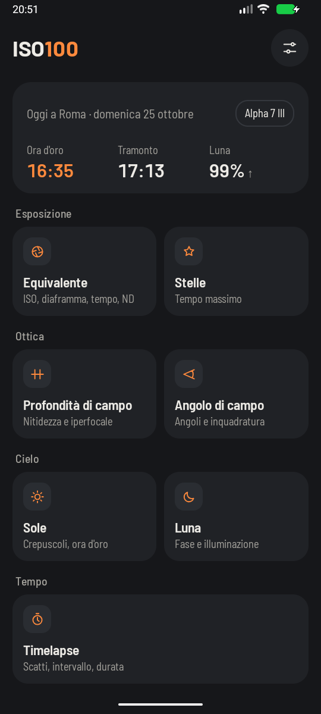

# Moon

**The question it answers:** how bright will the moon be, and where will I find it?

Photographers care about the moon for two opposite reasons. Sometimes it's the subject, and you want
to catch it in the right place. Other times it's the enemy, because moonlight washes out the Milky Way.
Either way you need the same information.

## Phase and illumination

The moon doesn't shine, it's a ball lit by the sun. As it circles the Earth, in about 29.5 days, we see
more or less of its lit side.

**Illumination** is the fraction of the visible disc that is lit, from 0% at new moon to 100% at full
moon. **The phase** puts a name on that: new, waxing crescent, first quarter, waxing gibbous, full,
waning gibbous, last quarter, waning crescent. Waxing means it's growing, waning that it's shrinking.

Both depend only on the moment, not on where you are: the phase is the same worldwide at any instant.
The app works from the exact date and time, because illumination can change by several percent in a
day. It also lists the next four main phases, with their dates.

Don't read illumination as a direct measure of brightness. A half moon, 50% lit, gives far less than
half the light of a full moon, since at full moon the sunlight hits it head on, with no shadows from
the craters.

## Rise, set and position

The app gives you the moonrise and moonset for the date, and for your chosen time its **altitude**
(degrees above the horizon, negative if it's below) and **direction** (north, north-east and so on).

Here's the pattern worth learning. The moon rises about 50 minutes later each day, so where it is
depends on its phase:

| Phase | Rises around | Sets around | Best for |
|---|---|---|---|
| New moon | Sunrise | Sunset | Dark skies, the Milky Way |
| First quarter | Midday | Midnight | High in the sky at dusk |
| Full moon | Sunset | Sunrise | Moonrise over a landscape |
| Last quarter | Midnight | Midday | Early morning, dark evenings |

Because of those 50 minutes, on some days the moon doesn't rise or doesn't set at all before the next
midnight, so don't be surprised if one of the two is missing. Close to the poles, it can stay up or
down for several days.

## How to use it in the field

**For the Milky Way**, look for the days around the new moon, or nights when the moon rises late or
sets early: combine this page with the full darkness times on the [Sun](sun.md) page.

**For a moon over a landscape**, try the evening *before* full moon, not the night of it. It rises
shortly before sunset, so the sky and the land still have light, and the moon is nearly full. A day
later it comes up after dark: the sky turns black, and the moon burns out against it.

**To expose the moon itself**, start from this old rule of thumb, called Looney 11: for a full moon, use
f/11 and a shutter of 1/ISO. So at ISO 100, f/11 and 1/100 s. It's sunlit rock, so it's much brighter
than people think, and your camera's meter will blow it out against the black sky. The rule is for a
full moon high in a clear sky: for thinner phases, give it more light, a stop or more as the crescent
gets thinner.

Use the [Equivalent exposure](exposure.md) tool to move that starting point to the settings you want,
and keep the shutter short: at a long focal length, the moon crosses the frame surprisingly fast. The
drift from [Stars without trails](stars.md) applies to it too.

## What the app can't know

- **The terrain.** Moonrise is computed for a flat horizon. Behind a ridge, the moon will appear later.
- **The precise spot.** The app tells you the direction in eight compass points, enough to know where
  to look. To line the moon up with a tower, you'll need to work out your position more carefully.
- **The clouds.** Always the last word.
