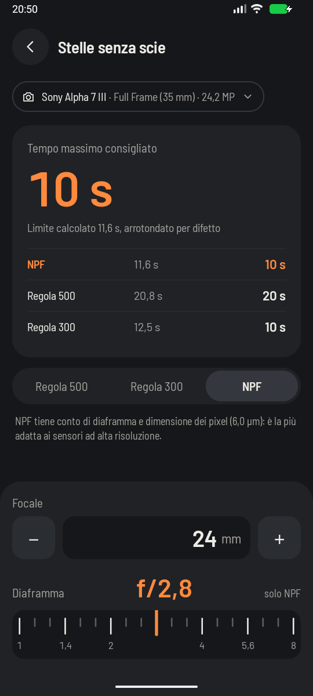

# Stars without trails



**The question it answers:** how long can I expose before the stars stop being points and turn into
little lines?

## The problem

Night sky pictures want two things that fight each other. You need a long exposure to gather enough
light, but the Earth is turning, so the stars drift across your sensor the whole time. Expose too long
and the points become streaks.

Let's put a number on it. The sky turns once a day, which is 0.0000729 radians per second. At the focal
plane, a star on the celestial equator moves by:

```text
drift per second = f · 0.0000729
```

For a 24 mm lens that's 1.75 µm per second. It doesn't sound like much, but pixels are only a few
microns wide. After 20 seconds, the star has crossed about 35 µm, which is six pixels on a 24 MP
full-frame sensor.

## The 500 rule

The oldest rule of thumb, and still the easiest to do in your head:

```text
limit = 500 / (f · crop factor)
```

Here's what's hiding in that 500. Multiply it by the drift above, and the focal length cancels out:
a star always travels 500 × 0.0000729 ≈ 0.036 mm. That's about one circle of confusion on full frame
(see [Depth of field](depth-of-field.md)). So the rule simply means: *let the trail be as long as the
blur we'd accept anyway.*

That was reasonable for film and for 12 MP cameras. On a modern sensor, 0.036 mm is many pixels, so
you'll see the trails as soon as you zoom in.

## The 300 rule

Same formula, stricter number: the trail is now about 0.022 mm. It's a simple way of admitting that
sensors have got denser.

```text
limit = 300 / (f · crop factor)
```

## The NPF rule

The 500 and 300 rules ignore two things: the size of your pixels and your aperture. NPF, devised by
Frédéric Michaud of the Société Astronomique du Havre, puts them in (the letters are its three
variables: aperture, pixel and focal length). The app uses the simplified form:

```text
limit = (35 · N + 30 · p) / f
```

N is the f-number, f the real focal length, with no crop factor, and p the pixel pitch in microns,
which comes from the sensor size and the resolution:

```text
p = √(sensor width · sensor height / pixels)
```

Smaller pixels shorten the limit, and that's expected, since they show the trails sooner. The aperture
may surprise you: a higher f-number *increases* the limit. Stopping down spreads each star into a
slightly larger spot, because of diffraction, and on a larger spot the same drift shows less. In
practice you still shoot as wide as your lens allows, because you need the light.

## Compare the rules

24 mm at f/2.8 on full frame, third-stop dial:

| Rule | Calculated limit | Shutter to use |
|---|---|---|
| 500 rule | 20.8 s | 20 s |
| 300 rule | 12.5 s | 10 s |
| NPF, 24 MP (6.0 µm pixels) | 11.6 s | 10 s |
| NPF, 45 MP (4.4 µm pixels) | 9.6 s | 8 s |

The 500 rule allows nearly twice the time of NPF at 24 MP. Now you see why people follow it and still
get disappointed at 100%.

On APS-C the same lens gets 13.6 s by the 500 rule: the crop factor is in the formula because the
frame shows less sky, so the same drift looks bigger.

## Reading the result

The app shows the rule you've chosen first, with the others underneath for comparison. The result is
**always rounded down** to a shutter speed on your dial, never to the nearest one: a limit is a limit.
The dial step matters here: with full stops, that 20.8 s becomes 15 s, since the next step up would be
30 s.

NPF is the default when your camera's resolution is in the catalog. Only 31 cameras have it, as an
unverified estimate, since most of the catalog comes from data without that detail. For the others, or
if you've chosen just a sensor format, NPF isn't offered and the default is the 500 rule.

## What the app can't know

- **Where you're pointing.** All these rules assume the worst case, stars on the celestial equator,
  which move the fastest. Aim near the celestial pole (the North Star, in the northern hemisphere) and
  stars barely move, so you can go longer.
- **How you'll use the picture.** For a small print or a phone screen, the 500 rule may be plenty. For
  a large print, trust NPF.
- **Your taste.** Not even NPF gives perfect points: this simplified form accepts a drift of about
  one star diameter. For truly round stars, use half the time. For a landscape with stars above, a
  touch of drift can be a fair price for less noise.

If you want more light than the limit allows, the usual answer is to take many exposures and stack
them in software, or to use a star tracker that follows the sky.
