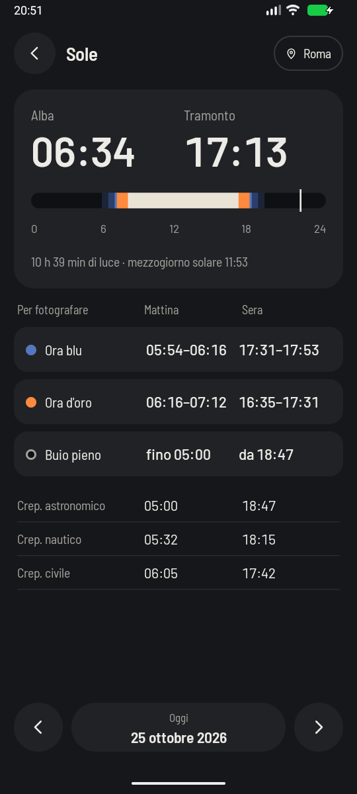

# Sun

**The question it answers:** at this place on this date, when will the light be good?

## The idea: light follows an angle

The quality of daylight has little to do with the clock, and everything to do with how high the sun
is. So the app doesn't work with times of day, it works with the sun's **altitude**, the angle between
the sun and the horizon. It finds when the sun crosses certain angles at your location on your date,
and shows the result on a band covering the 24 hours.

The low sun is what we're chasing. Its light passes through much more air, which filters out the blue
and leaves warm, soft, directional light. And when the sun drops below the horizon, the sky itself
becomes a huge, soft, blue light source.

| Sun altitude | Name | What the light does |
|---|---|---|
| Above +6° | Day | Hard light, short shadows around midday |
| −4° to +6° | Golden hour | Warm, low, long shadows |
| −6° to −4° | Civil twilight, blue hour | Rich blue, the landscape still readable |
| −8° to −6° | Nautical twilight, blue hour | Deep blue, city lights balance with the sky |
| −12° to −8° | Nautical twilight | Horizon fading, first bright stars |
| −18° to −12° | Astronomical twilight | Nearly dark, faint glow remains |
| Below −18° | Night | Full darkness, the best time for the Milky Way |

Notice two things. First, the golden hour isn't one hour, and it doesn't stop at sunset: it starts
*before* the sun comes up and carries on past sunset, down to −4°. Second, the names overlap. Twilights
are formal definitions (0°, −6°, −12° and −18°), while blue and golden hour are photographers' terms.
The band shows one colour per moment, so between −4° and 0° it shows the golden hour rather than civil
twilight.

Those angles aren't universal, because the golden and blue hour have no official definition. For the
golden hour, −4° to +6° is the most common choice, though some planning apps start it at 0°. For the
blue hour you'll find both −8° to −4° and the narrower −6° to −4° used by PhotoPills, so another app
may give you a shorter blue hour. The app uses the thresholds of commons-suncalc, the library behind
its calculations.

## Sunrise and sunset

Sunrise isn't the moment the sun's centre reaches the horizon. It's the moment its upper edge appears.
And the atmosphere bends the light, lifting the sun's image by about half a degree, so you can see it
while it is geometrically below the horizon. Together, they put sunrise and sunset at around −0.83°
for the sun's centre.

The other figures on the screen are the length of the day and **solar noon**, when the sun is at its
highest. That's rarely 12:00, because of your position in the time zone and daylight saving time.

## How long does it last?

It depends on the angle at which the sun crosses the horizon, and so on your latitude and the season.
Near the equator the sun drops almost straight down, and twilight is over in minutes. At high latitude
it sinks at a shallow slant, and the golden hour can go on and on.

In the far north it can get strange. In midsummer in Tromsø the sun doesn't set, so the app tells you
that, rather than giving you a sunset that doesn't exist, and the evening golden hour runs past
midnight into the next day. In winter, the opposite: the sun doesn't rise at all.

So never assume last week's times still hold, and never carry them to a different place. Check the
app for the actual date and place.

## Places and time zones

You can use your current position, or search for a place by name and save it. Scouting a location from
home is the classic case: pick the place and the date of your trip, and plan.

Times are always shown in the place's time zone, not your phone's. A new saved place starts with your
phone's zone, because the app works offline and can't work it out from the coordinates. So if you save
Reykjavík from Rome, **change the zone of the place** or the times will be off by an hour or two.

## How to use it in the field

- **Be there early.** For the golden hour, arrive 30 minutes before and be set up. It moves fast.
- **Stay after sunset.** Most people pack up when the sun disappears. The best colour in the sky often
  comes ten minutes later.
- **Shoot cities in the blue hour.** That's when the lights in the windows match the brightness of
  the sky. Ten minutes later the sky is black, and the balance is gone.
- **Plan the Milky Way around full darkness**, and check the [Moon](moon.md) too.

## What the app can't know

- **The terrain.** Calculations assume a flat horizon. In a valley, the sun disappears behind the
  mountains long before official sunset.
- **The weather.** The sky decides. A good sky comes from broken cloud at the right height, and there's
  no formula for that.
- **Precision.** The times are good to about a minute, which is plenty for photography.
