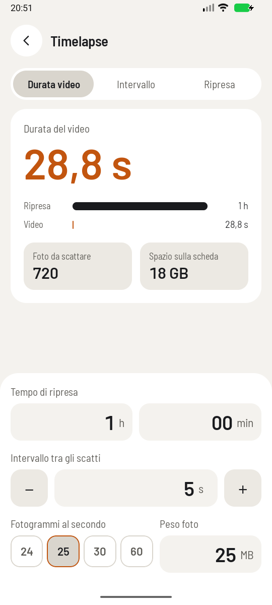

# Timelapse



**The question it answers:** how long do I have to shoot, how often, and how many photos will that be,
to get the video I want?

## The idea

A timelapse is a video in which each frame is a photo. Video plays at a fixed rate, 25 frames per
second for instance, so each second of the finished clip needs 25 photos. If you take one photo every
5 seconds, each second of video has swallowed 125 seconds of real time.

Everything comes from that one relationship, between four numbers:

```text
photos = frames per second · video length
shooting time = photos · interval
```

The app rounds the photos to a whole number, and that's the only rounding it does.

Fix any two of the durations and the third follows. The app lets you choose which one to calculate:

| You know | You get |
|---|---|
| Interval and shooting time | Video length = shooting time / (interval · fps) |
| Video length and shooting time | Interval = shooting time / (fps · video length) |
| Video length and interval | Shooting time = interval · fps · video length |

## Worked examples

**"The sunset gives me an hour. What will I get?"** One hour, a photo every 5 s, 25 fps:

```text
video length = 3600 / (5 · 25) = 28.8 s
photos       = 720
```

**"I want a 30 s clip from that hour."** So how often should I shoot?

```text
interval = 3600 / (25 · 30) = 4.8 s
```

**"How long do I have to stay for 30 seconds of clouds at one every 5 s?"**

```text
shooting time = 5 · 25 · 30 = 3750 s = 1 h 2 min 30 s
photos        = 750
```

## Space on the card

The app multiplies the photos by the size of one file, 25 MB by default, and using 1 GB = 1000 MB as
card makers do. Those 720 photos make 18 GB. Clear the size field if you'd rather not have the
estimate.

Raw files of a high-resolution camera can easily be 50 MB or more, so check one on your own camera.

## Choosing the interval

The maths tells you the length, not what looks good. The interval depends on how fast your subject
moves. These starting points work well:

| Subject | Interval |
|---|---|
| People, traffic | 1–2 s |
| Fast clouds | 2–5 s |
| Slow clouds, sunset | 5–10 s |
| Moving shadows, the sun | 15–30 s |
| Stars | 20–30 s (with the exposure close behind) |

And choose the frame rate first: 24 or 25 for a film look, 30 is common online, and 60 gives you very
smooth motion but eats twice the photos.

## What the app can't know

- **The exposure has to fit.** The interval must be longer than the shutter time, plus the time your
  camera needs to write the file. For stars at 20 s, a 21 s interval may not be enough; test it.
- **Battery.** An hour of continuous shooting is hard on a battery. On a cold night, even more so.
- **Flicker.** If you let the camera adjust the exposure, each frame jumps slightly, and the video
  flickers. Use manual exposure, manual focus and fixed white balance.
- **A long shutter is smoother.** A little motion blur in each frame makes the video flow, and that's
  where an ND filter earns its keep during the day: see
  [Equivalent exposure and ND filters](exposure.md).
